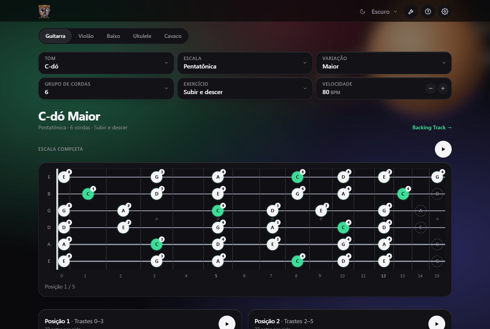
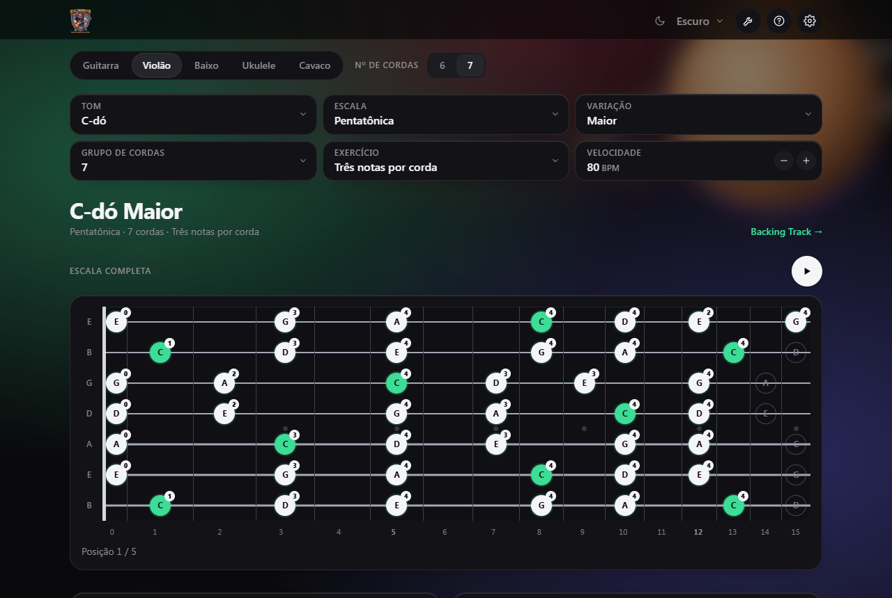
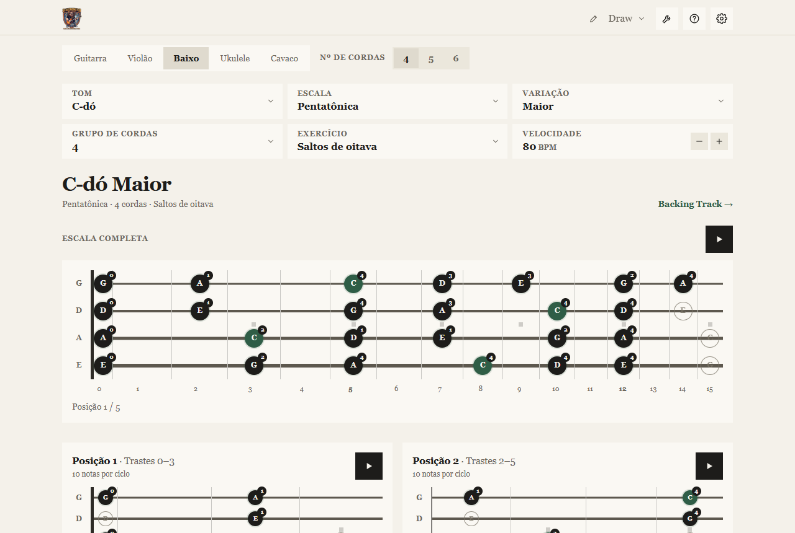
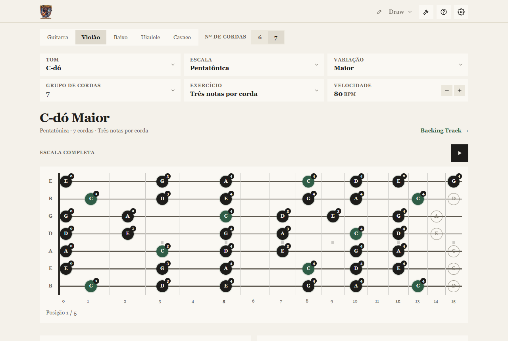
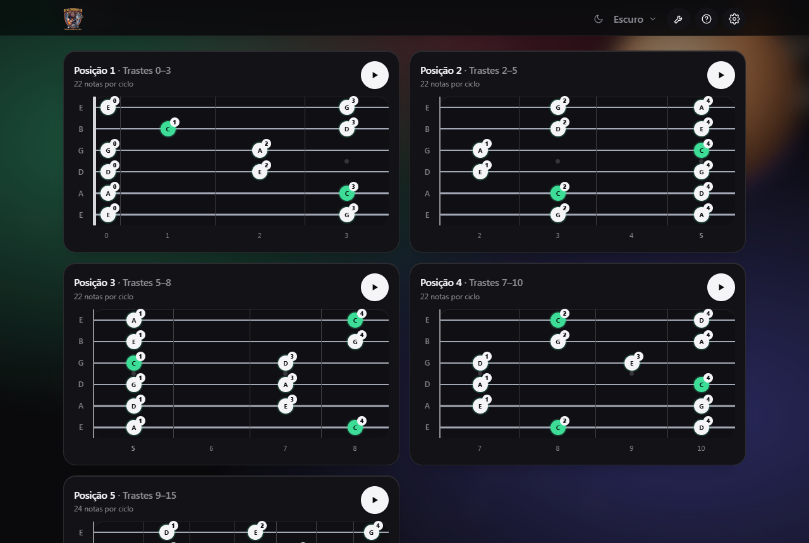
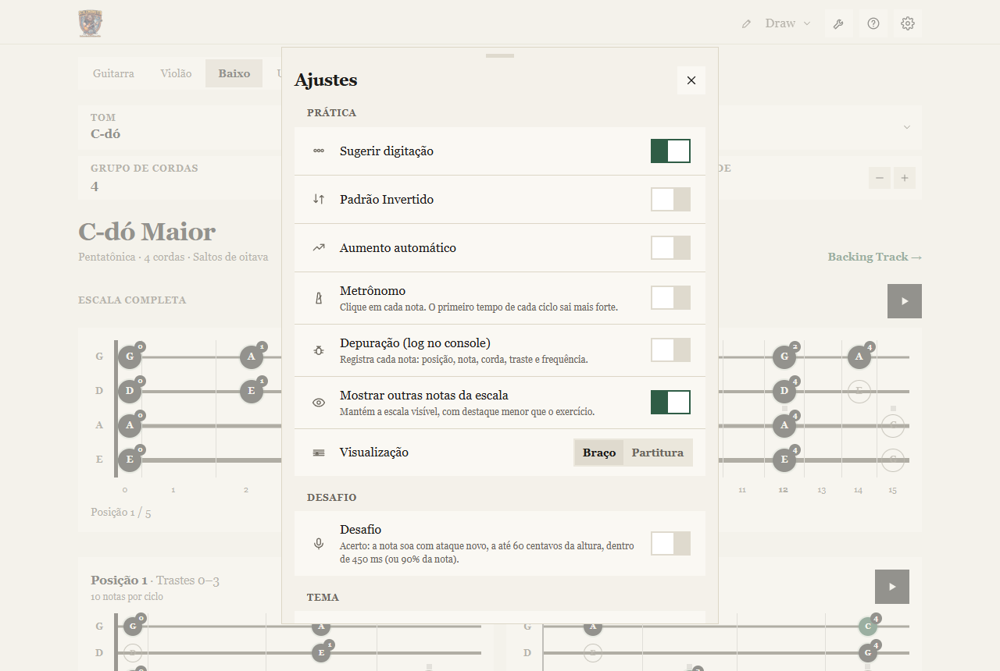
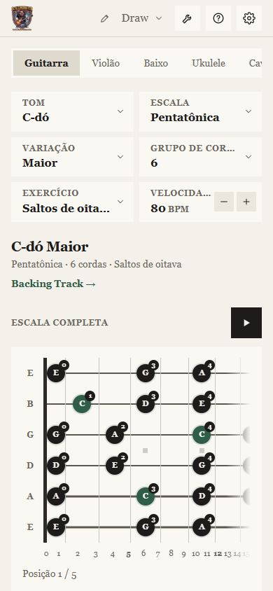
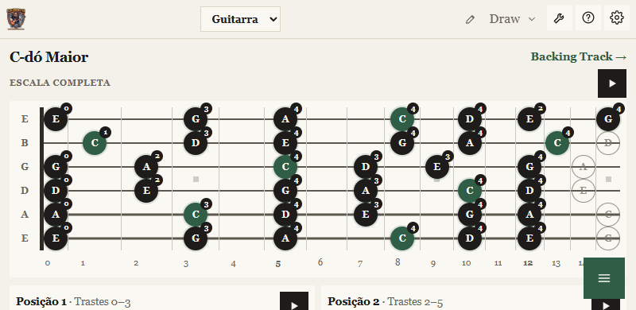

<p align="center">
  
</p>

<h3 align="center">Domine as escalas de guitarra, violão, baixo, ukulele e cavaco</h3>

<p align="center">
  <a href="https://iratuan.github.io/scaleMonster/"><strong>▶ Abrir a versão web</strong></a>
  &nbsp;·&nbsp;
  <a href="#downloads"><strong>⬇ Baixar</strong></a>
  &nbsp;·&nbsp;
  <a href="#como-rodar"><strong>⚙ Rodar localmente</strong></a>
</p>

<p align="center">
  
  
  
  
</p>

---

## O que é

O **ScaleMonster** mostra as escalas no braço do seu instrumento, toca cada nota com o som certo
e confere, pelo microfone, se você tocou a nota certa. Pratique sozinho, no navegador, no computador
ou no celular, sem instalar nada para usar a versão web.

<p align="center">
  
</p>

## Destaques

- 🎸 **Cinco instrumentos:** guitarra, violão (6 ou 7 cordas), baixo (4, 5 ou 6), ukulele e cavaquinho.
- 🎼 **15 padrões de exercício:** de subir e descer a saltos de oitava, passando por arpejos, grupos,
  saltos de terça, de quarta e de quinta, saltos de corda, três notas por corda e a ordem de dedos 1-3-2-4.
- 🗺️ **Escala completa e cinco posições:** o braço inteiro em um percurso contínuo, com as posições
  tocadas uma de cada vez e a digitação sugerida.
- 🔊 **Som de verdade:** cada nota é sintetizada na frequência exata da corda e do traste.
- 🎤 **Modo desafio:** toque no microfone e veja, nota por nota, se você acertou.
- 🎵 **Ferramentas:** metrônomo com subdivisões e aceleração, afinador com referência A4 ajustável
  e backing track.
- 🎨 **Temas:** Escuro, Claro, Vintage, Madeira e **Draw**, um tema de papel, flat e minimalista.
- 📱 **Qualquer tela:** desktop, celular em retrato e na horizontal. Funciona offline como app (PWA).

## Telas

<table>
  <tr>
    <td align="center" width="50%">
      <br>
      <sub><b>Violão de 7 cordas</b>, com o exercício "Três notas por corda"</sub>
    </td>
    <td align="center" width="50%">
      <br>
      <sub><b>Baixo</b>, com o exercício "Saltos de oitava"</sub>
    </td>
  </tr>
  <tr>
    <td align="center" width="50%">
      <br>
      <sub><b>Tema Draw</b>: papel creme, sem arredondamentos nem sombras</sub>
    </td>
    <td align="center" width="50%">
      <br>
      <sub><b>Cinco posições</b>, cada uma tocada no seu próprio cartão</sub>
    </td>
  </tr>
  <tr>
    <td align="center" width="50%">
      <br>
      <sub><b>Ajustes</b>: digitação, desafio, tema e idioma</sub>
    </td>
    <td align="center" width="50%">
      <br>
      <sub><b>Celular</b>, em retrato</sub>
    </td>
  </tr>
  <tr>
    <td align="center" colspan="2">
      <br>
      <sub><b>Celular na horizontal</b>, com o braço em destaque</sub>
    </td>
  </tr>
</table>

## Exercícios

| # | Padrão | Como é |
| --- | --- | --- |
| 1 | Subir e descer | A escala inteira, para cima e para baixo |
| 2 e 3 | Cada nota 2 ou 3 vezes | Repetição de cada nota |
| 4 e 5 | Grupos de 3 e de 4 | Notas em blocos deslizantes |
| 6 | Saltos de terça | 1-3, 2-4, 3-5... |
| 7 e 8 | Arpejos | Tríades e tétrades da escala |
| 9 | Saltos de corda | 6-4, 5-3, 4-2... |
| 10 | Vai e volta | 1-2-1, 2-3-2... |
| 11 e 12 | Saltos de quarta e de quinta | 1-4, 2-5... e 1-5, 2-6... |
| 13 | Três notas por corda | Sobe corda a corda e volta |
| 14 | Ordem de dedos 1-3-2-4 | Grupos de quatro notas |
| 15 | Saltos de oitava | Nota e a mesma nota uma oitava acima ou abaixo |

## Downloads

Os arquivos ficam na pasta `release/` e não estão no repositório. Use a versão web para testar sem instalar.

| Plataforma | Arquivo | Observação |
| --- | --- | --- |
| **Web** | `ScaleMonster-web-1.4.2.zip` ou [a versão online](https://iratuan.github.io/scaleMonster/) | Não exige instalação |
| **Windows** | `ScaleMonster Setup 1.4.2.exe` (instalador) ou `ScaleMonster 1.4.2.exe` (portátil) | Sem assinatura: o SmartScreen pode avisar |
| **Android** | `ScaleMonster-1.4.2-android.apk` | Versão de depuração; permita a instalação de fontes desconhecidas |
| **macOS** | gerado a partir do código, num Mac | Veja [`docs/build-macos.md`](docs/build-macos.md) |

Os hashes SHA-256 de cada versão estão em [`docs/evidencias/builds/`](docs/evidencias/builds/).

## Como rodar

Requisito: **Node.js 20** ou mais recente.

```bash
npm ci          # instala as dependências
npm run dev     # abre o servidor de desenvolvimento
```

Depois abra o endereço que aparece no terminal.

| Comando | O que faz |
| --- | --- |
| `npm run dev` | Servidor de desenvolvimento |
| `npm test` | Roda os 97 testes automatizados |
| `npm run typecheck` | Verificação de tipos |
| `npm run build` | Gera `dist/`, a versão web |
| `npm run electron:build` | Gera o instalador e o portátil do Windows em `release/` |
| `npm run electron:build:mac` | Gera o DMG e o ZIP do macOS (precisa de um Mac) |
| `npm run cap:sync` | Copia `dist/` para o projeto Android |

Para o APK: `npx cap sync android` e depois `cd android && ./gradlew assembleDebug`.

## Publicação

A versão web é publicada automaticamente no GitHub Pages a cada push na branch `main`, pelo workflow
[`.github/workflows/pages.yml`](.github/workflows/pages.yml). Para isso, a fonte do Pages precisa estar
em **Settings → Pages → Source: GitHub Actions**.

## Estrutura

```
src/core/        lógica musical sem interface: escalas, posições, exercícios, digitação,
                 partitura, julgamento de notas, afinador, metrônomo e textos
src/ui/          React: telas, componentes e o hook de reprodução
src/audio/       síntese, sequenciador, microfone e metrônomo (Web Audio)
src/styles/      tokens de cor (temas), camadas de estilo e o tema madeira
src/assets/      logomarca e personagem
electron/        casca desktop (Electron)
android/         projeto Android (Capacitor)
public/          ícones do PWA e manifesto
buildResources/  ícones do instalador (Windows e macOS)
scripts/         capturas de tela, verificações e geração de ícones
docs/            progresso, evidências, instruções de build e distribuição
```

Os instrumentos são dados: afinação, trastes e filtros de cordas ficam em `src/core/instruments.ts`.
O mesmo componente de braço desenha qualquer instrumento.

## Decisões de projeto

- **Instrumentos como dados.** Adicionar um instrumento de cordas é acrescentar uma afinação.
- **Motor sem interface.** Escalas, posições e exercícios são funções puras, testadas em todas as
  combinações de instrumento, tom, escala e grupo de cordas.
- **Posições em janelas de cinco trastes.** As formas CAGED valem para violão e guitarra; os demais
  instrumentos usam o gerador de digitação.
- **Escala completa em percurso.** A posição 1 abre varrendo as cordas, do grave ao agudo. Depois, cada
  posição é percorrida numa direção, e a seguinte começa perto de onde a anterior terminou. Notas de
  ligação são tocadas, nunca puladas.
- **Um código, várias plataformas.** A mesma base gera o site, o app de desktop e o app Android.

## Qualidade

- **97 testes automatizados:** teoria musical, todas as combinações de instrumento e tom, posições,
  exercícios, partitura, digitação, julgamento de notas e interface.
- **Verificação de tipos** sem erros.
- **Evidências** em [`docs/evidencias/`](docs/evidencias/): capturas, resultados de testes e registros de build.

## Limitações conhecidas

- **Som:** o sintetizador de cordas ainda não foi comparado com um instrumento real.
- **Desafio pelo microfone:** os limiares foram ajustados em testes, não com um instrumento real em ambiente barulhento.
- **macOS:** o build não foi gerado nem testado neste projeto.
- **Assinatura:** os instaladores de Windows e Android não são assinados.
- **Testes em aparelho:** a verificação foi feita no navegador e em emuladores; não há testes em uma grade ampla de celulares.
- **Acordes:** no violão e na guitarra, só maior, menor e 7 têm formas CAGED; os demais tipos usam o gerador de digitação.

## Origem

Este projeto é um fork do [guitarra-escalas](https://github.com/heltongoncalves/guitarra-escalas),
de Helton Gonçalves, usado com autorização do autor. A versão original em JavaScript puro foi
refatorada para React e TypeScript, com novos instrumentos, exercícios, temas e a marca ScaleMonster.

## Documentação

- [`docs/progresso.md`](docs/progresso.md): histórico de decisões e de mudanças.
- [`docs/build-macos.md`](docs/build-macos.md): como gerar o app para MacBook.
- [`docs/distribuicao-web.md`](docs/distribuicao-web.md): como publicar a versão web por conta própria.

## Licença

Ainda não definida. Até lá, todos os direitos sobre o código são reservados ao autor, e o uso deve ser
combinado com ele. Antes de publicar uma licença, confirme também os termos do projeto original.
