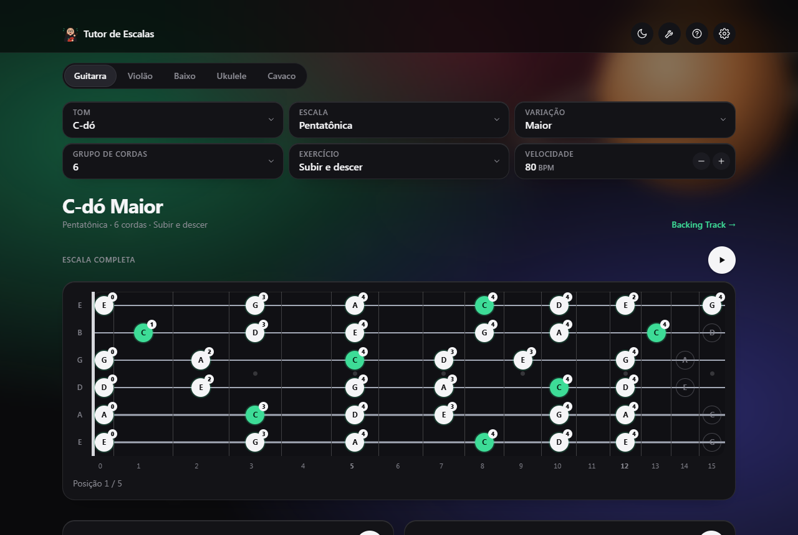
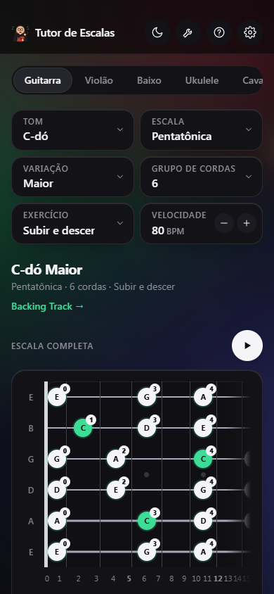
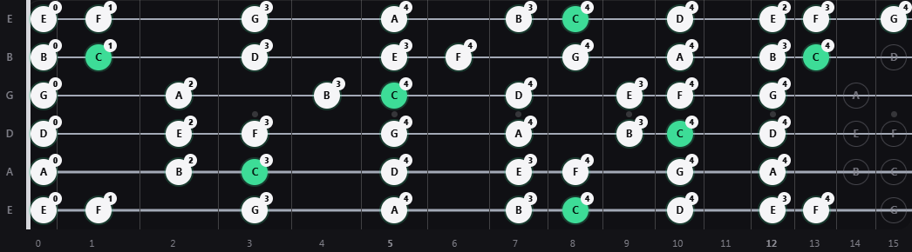
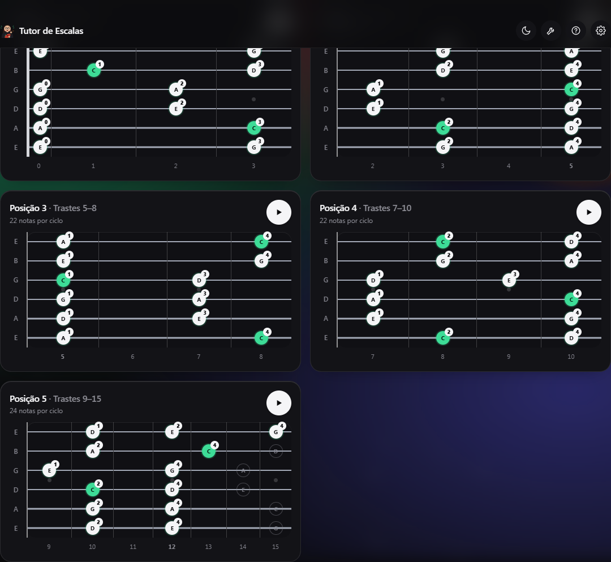
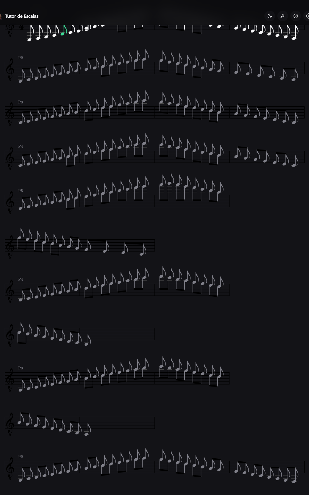
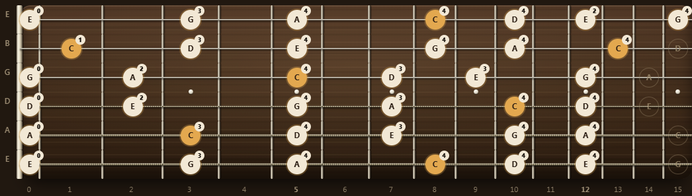
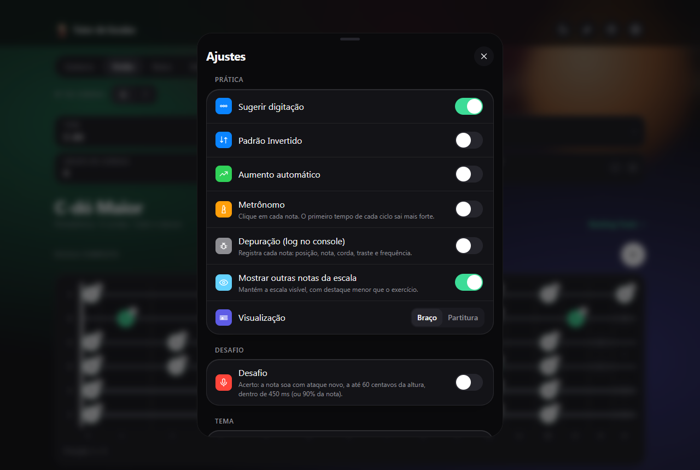
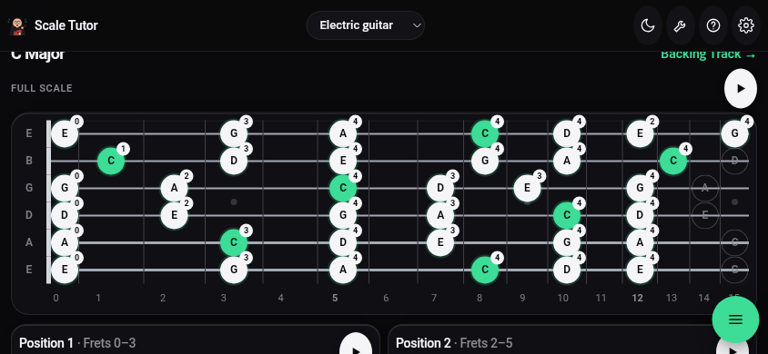
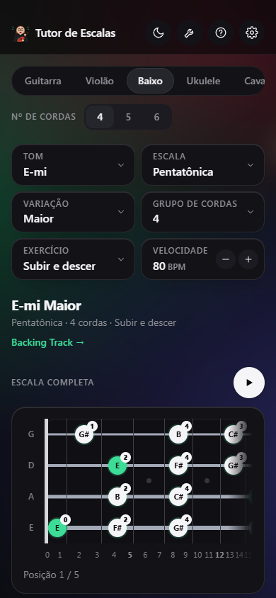

# ScaleMonster

> Aprenda escalas no braço do seu instrumento, com um mascote que não tem medo de errar o tom.

O **ScaleMonster** mostra as escalas no braço, toca cada nota, percorre as cinco posições
e confere se você tocou certo pelo microfone. Funciona no navegador, no Windows, no Android
e (a gerar) no macOS.

**Versão 1.4.0.** Idiomas iniciais: português, inglês e alemão.

---

## Telas

| Tela principal (desktop) | Celular |
| --- | --- |
|  |  |

### Escala completa no braço

A escala completa começa na posição 1, corda a corda, do grave ao agudo, e segue em zigue-zague pelas posições, marcando as notas de cada passagem.



### Posições lado a lado

Em telas largas, as posições ficam em duas colunas. No celular, uma abaixo da outra.
Cada posição é tocada sozinha, e tocar uma interrompe a anterior.



### Partitura

Qualquer exercício pode ser lido na pauta, com a clave escolhida para cada instrumento.
As posições ganham uma linha própria.



### Tema madeira



### Ajustes



### Celular na horizontal (Android)

Na paisagem, o cabeçalho fica fino, as escolhas cabem numa faixa e o braço ganha altura.



### Baixo no celular



Mais capturas em [`docs/evidencias/telas/`](docs/evidencias/telas/).

---

## Funcionalidades

- **Cinco instrumentos de cordas:** guitarra (6 cordas), violão (6 ou 7), baixo (4, 5 ou 6), ukulele (4, reentrante) e cavaquinho (4).
- **Escalas e modos:** tom, escala, variação, grupo de cordas e velocidade.
- **Exercícios:** subir e descer, repetições, grupos de três e quatro notas, saltos de terça, acordes, saltos de cordas e a escala completa.
- **Escala completa em zigue-zague:** começa na posição 1, varrendo as cordas da mais grave para a mais aguda. Depois sobe a 2, desce a 3, sobe a 4 e desce a 5; volta pela 4 (sobe), 3 (desce) e 2 (sobe), e fecha subindo pela 1. Cada passagem marca as notas que serão tocadas, e as notas de ligação entre posições são tocadas também.
- **Posições:** cinco janelas de trastes, tocadas uma de cada vez, com digitação sugerida.
- **Partitura:** pauta com clave (sol, fá, dó, com ou sem oitava), com destaque da nota atual.
- **Desafio:** toque no microfone e o app confere a altura de cada nota (com aviso sobre o uso de fones).
- **Ferramentas:** metrônomo com subdivisões, compassos e aceleração; afinador com a referência A4 ajustável.
- **Temas:** escuro, claro, vintage e madeira, com braço realista no tema madeira.
- **Idiomas:** português, inglês e alemão.
- **Curiosidades:** uma piada ou fato sobre guitarristas e baixistas a cada abertura do app.
- **Uso offline:** o app pode ser instalado como aplicativo (PWA) e funciona sem internet depois da primeira visita.

---

## Como rodar

Requisitos: Node.js 20 ou mais recente.

```bash
npm ci            # instala as dependências
npm run dev       # servidor de desenvolvimento
```

Abra o endereço mostrado no terminal.

### Comandos

| Comando | O que faz |
| --- | --- |
| `npm run dev` | Servidor de desenvolvimento |
| `npm test` | Roda a suíte de testes (93 testes) |
| `npm run typecheck` | Verificação de tipos |
| `npm run build` | Gera `dist/` (versão web) |
| `npm run electron:build` | Gera o instalador e o executável portátil do Windows em `release/` |
| `npm run electron:build:mac` | Gera o DMG e o ZIP para macOS (precisa de um Mac; ver `docs/build-macos.md`) |
| `npm run cap:sync` | Copia `dist/` para o projeto Android |

Para o APK: `npx cap sync android` e depois `cd android && ./gradlew assembleDebug`.

---

## Distribuição

| Plataforma | Como obter | Documentação |
| --- | --- | --- |
| Web | `release/ScaleMonster-web-1.4.0.zip` (site estático) | [`docs/distribuicao-web.md`](docs/distribuicao-web.md) |
| Windows | `release/ScaleMonster Setup 1.4.0.exe` (instalador com seletor de idioma) ou `ScaleMonster 1.4.0.exe` (portátil) | `npm run electron:build` |
| Android | `release/ScaleMonster-1.4.0-android.apk` (depuração) | seção "Como rodar" acima |
| macOS | a gerar num Mac | [`docs/build-macos.md`](docs/build-macos.md) |

Os instaladores ainda não estão assinados. No Windows, o SmartScreen pode avisar sobre o editor.
No Mac e no Android, pode ser preciso liberar a instalação manualmente.

---

## Estrutura

```
src/core/        lógica musical sem interface: escalas, posições, exercícios, digitação,
                 partitura, julgamento de notas, afinador, metrônomo e textos
src/ui/          React: telas, componentes e o hook de reprodução
src/audio/       síntese, sequenciador, microfone e metrônomo (Web Audio)
src/styles/      tokens de cor (temas), camadas de estilo e o tema madeira
electron/        casca desktop (Electron)
android/         projeto Android (Capacitor)
public/          ícones, logomarca e manifesto de aplicativo
buildResources/  ícones do instalador (Windows e macOS)
scripts/         capturas de tela, verificações e geração de ícones
docs/            progresso, evidências, instruções de build e distribuição
```

Os instrumentos são dados: afinação (MIDI), trastes e filtros de cordas, em `src/core/instruments.ts`.
O mesmo componente de braço desenha qualquer instrumento.

---

## Decisões de projeto

- **Instrumentos como dados.** Adicionar um instrumento de cordas é acrescentar uma afinação.
- **Motor sem interface.** Escalas, posições e exercícios são funções puras, testadas com todas as combinações de instrumento, tom, escala e grupo de cordas.
- **Posições em janelas de cinco trastes.** As formas CAGED valem para violão e guitarra; os outros instrumentos usam o gerador de digitação.
- **Escala completa em zigue-zague.** A posição 1 abre varrendo as cordas, do grave ao agudo. Depois, cada posição é percorrida numa direção, e a seguinte começa perto de onde a anterior terminou. Notas de ligação são tocadas, nunca puladas.
- **Estilo flat com material.** Superfícies translúcidas e fundo espacial desfocado, sem sombras pesadas. O braço é opaco, para que as notas fiquem nítidas.
- **Tom bem-humorado.** Os textos do app e do instalador são leves, sem perder a clareza.

---

## Qualidade

- **93 testes automatizados**, cobrindo teoria musical, todas as combinações de instrumento e tom, posições, exercícios, partitura, digitação, julgamento de notas e interface.
- **Verificação de tipos** sem erros.
- **Testes de interface no navegador** (`scripts/bateria-visual.mjs`): abre cada tela e confere erros de console.
- **Evidências** em [`docs/evidencias/`](docs/evidencias/): capturas, resultados de testes e registros de build.

---

## Limitações conhecidas

- **Som:** o sintetizador de cordas ainda não foi comparado com um instrumento real.
- **Desafio pelo microfone:** os limiares de ataque e de altura foram ajustados em testes, mas não com um instrumento real em ambiente barulhento.
- **macOS:** o build não foi gerado nem testado neste projeto.
- **Assinatura:** os instaladores não são assinados.
- **Dicionário de acordes:** arquivado em `arquivo/dicionario-acordes/` até a funcionalidade ser revisada (ver o `LEIA-ME.md` dentro da pasta).
- **Acordes:** no violão e na guitarra, só maior, menor e 7 têm formas CAGED. Os demais tipos usam o gerador de digitação.

---

## Documentação

- [`docs/progresso.md`](docs/progresso.md): histórico de decisões e de mudanças.
- [`docs/evidencias/README.md`](docs/evidencias/README.md): como as evidências são geradas.
- [`docs/build-macos.md`](docs/build-macos.md): como gerar o app para MacBook.
- [`docs/distribuicao-web.md`](docs/distribuicao-web.md): como publicar a versão web.

---

## Créditos

Mascote e logomarca: uma guitarrista de óculos, cabelo solto e muito entusiasmo no headbang.
Fontes: as do sistema operacional, sem fontes externas.
